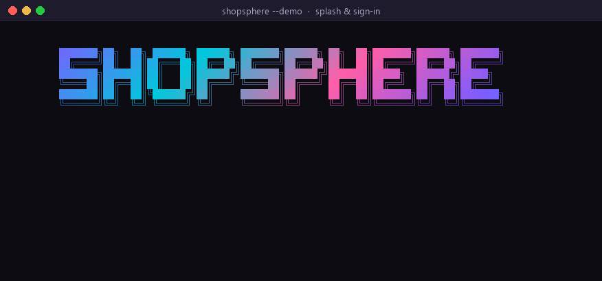
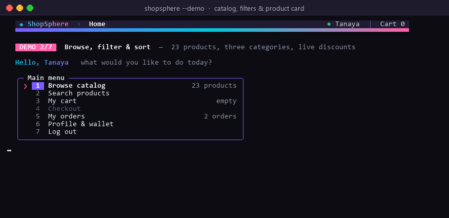
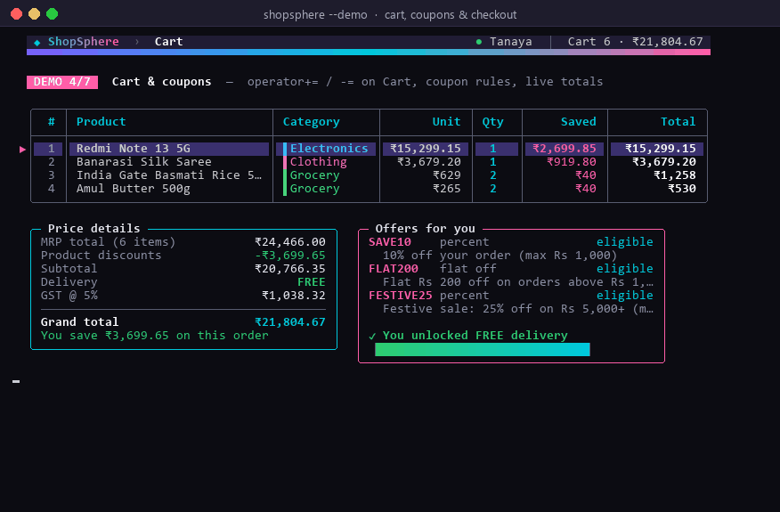
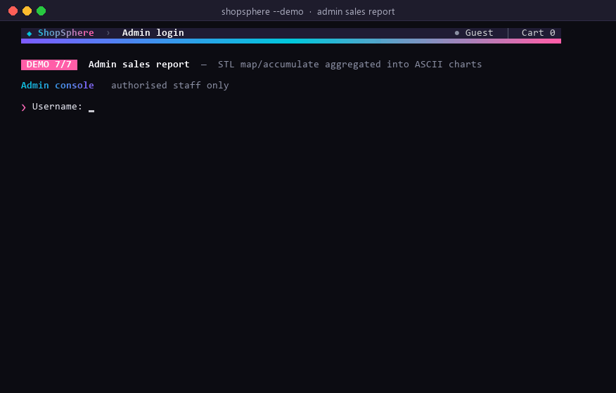
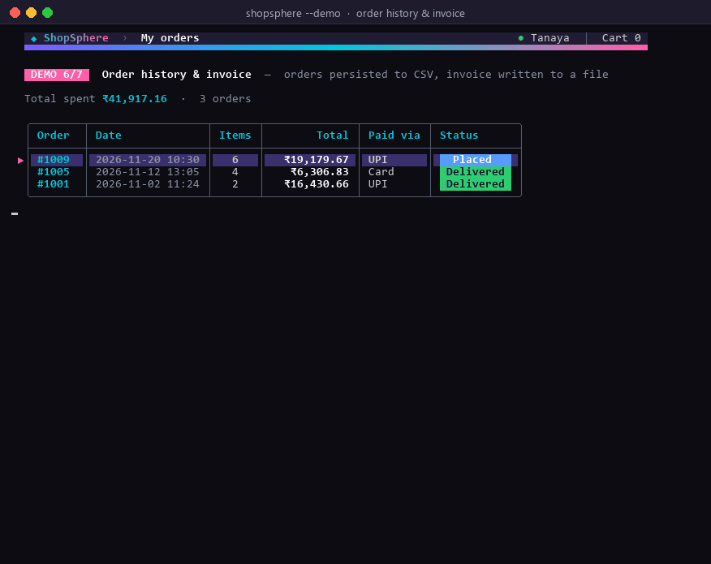
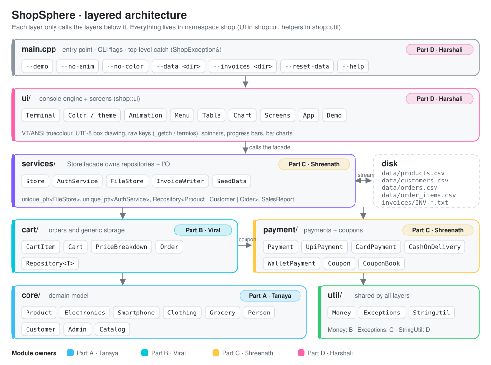
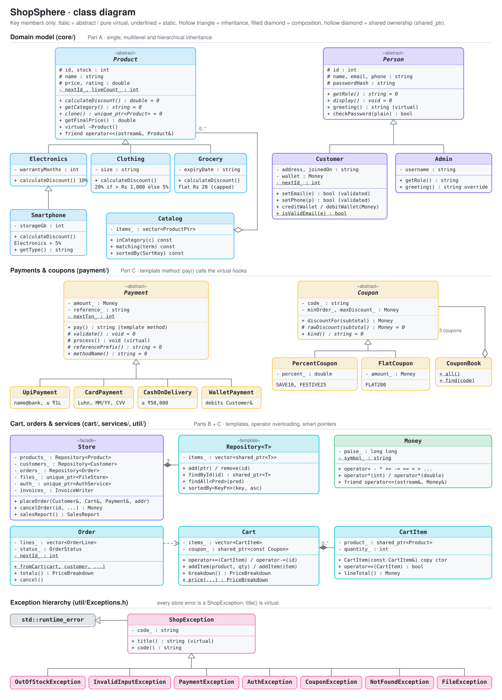

<div align="center">




<br>

[](#-quick-start)
[](#-quick-start)
[](#-quick-start)
[](LICENSE)
[](#-oop-concepts-and-where-to-find-them)
[](#-controls)
[](#-architecture)

<br>

[](#-features)
[](#-quick-start)
[](#-architecture)
[](#-oop-concepts-and-where-to-find-them)
[](#-team)
[](#-documentation)

<br>

**ShopSphere** is a console e-commerce store written in standard C++14 for the
Object-Oriented Programming course at **VIT Pune**.<br>
Browse a catalog, fill a cart, apply coupons, pay with UPI / card / COD / wallet, get an invoice,
and run the admin sales report. Everything is drawn in the terminal by a small ANSI UI engine we wrote ourselves.

</div>

---

## 🎬 Demo

The clips below follow the built-in scripted walkthrough (`shopsphere --demo`). The demo uses fixed seed
data and a fixed clock (2026-11-20 10:30), so your own run prints the same products, totals and order number.

<table>
<tr>
<td width="50%" valign="top">

**1 · Splash and sign-in**<br>
<sub>Gradient logo with shimmer, typewriter tagline, loading bars, arrow-key menu, masked password.</sub>



</td>
<td width="50%" valign="top">

**2 · Catalog, filters and product card**<br>
<sub>Box-drawn table, category filter, sort by biggest discount, search, product card with polymorphic offer text.</sub>



</td>
</tr>
<tr>
<td width="50%" valign="top">

**3 · Cart, coupons and checkout**<br>
<sub>Invalid coupon raises <code>CouponException</code>, FESTIVE25 applies, a declined card plays the failure animation, then UPI succeeds.</sub>



</td>
<td width="50%" valign="top">

**4 · Admin sales report**<br>
<sub>KPI tiles, animated revenue-by-category and top-product bar charts, payment mix and low-stock alerts.</sub>



</td>
</tr>
</table>

<details>
<summary><b>More: order history, order detail and the generated invoice</b></summary>
<br>

</details>

---

## ✨ Features

<table>
<tr>
<td width="33%" valign="top">

### 🛍️ Shopping
- 23 seeded products in **Electronics**, **Clothing** and **Grocery** (two Smartphones)
- Filter by category, sort 6 ways, search by name or type
- Product card with MRP, offer price, rule text and a stock meter
- Cart with `+`/`-` quantity, remove, empty, live totals

</td>
<td width="33%" valign="top">

### 💳 Checkout
- 3-step stepper: Address → Payment → Confirmation
- **UPI**, **Card** (Luhn + expiry + CVV), **Cash on Delivery**, **Wallet**
- Coupons **SAVE10**, **FLAT200**, **FESTIVE25** with eligibility hints
- Plain-text invoice written to `invoices/INV-<id>.txt`

</td>
<td width="33%" valign="top">

### 👤 Accounts
- Log in, register (₹500 welcome bonus) or shop as a guest
- Validated email, 10-digit mobile and password rules
- Order history with status badges, cancel with restock and refund
- Profile editing and wallet top-up

</td>
</tr>
<tr>
<td valign="top">

### 🛠️ Admin console
- Dashboard: revenue, average order, units, catalog size
- Animated bar charts, top-5 products, payment mix
- Add / restock / reprice / delete products
- Advance orders Placed → Shipped → Delivered, low-stock alerts

</td>
<td valign="top">

### 🎨 Console UI engine
- 24-bit ANSI colours, rounded box drawing, gradients
- Arrow-key menus (also `j`/`k` and number keys)
- Tables with highlighted rows, spinners, progress bars, charts
- Falls back to plain text when output is piped or `--no-color` is set

</td>
<td valign="top">

### 💾 Persistence
- CSV files in `data/` loaded at start and saved after every change
- Quoted CSV fields, malformed rows skipped instead of crashing
- `--reset-data` rewrites the built-in seed
- No third-party libraries, only the C++ standard library

</td>
</tr>
</table>

---

## 🚀 Quick Start

You need a C++14 compiler (GCC 6.3+ / MinGW, Clang or MSVC). Run every command **from the repository root**,
because the app reads `data/` and writes `invoices/` relative to the current folder.

<details open>
<summary><b>🪟 Windows (MinGW g++)</b></summary>

```bat
build.bat          :: build bin\shopsphere.exe and the test programs
build.bat run      :: build, then start the app
build.bat demo     :: build, then run the scripted walkthrough
build.bat test     :: build, then run the tests
build.bat clean    :: delete build\ and bin\
```
</details>

<details>
<summary><b>🐧 Linux / 🍎 macOS (or Git Bash)</b></summary>

```bash
chmod +x build.sh
./build.sh          # build bin/shopsphere and the test programs
./build.sh run      # start the app
./build.sh demo     # scripted walkthrough
./build.sh test     # run the tests
```
</details>

<details>
<summary><b>🧰 GNU make / mingw32-make</b></summary>

```bash
make               # app + tests
make run           # interactive app
make demo          # scripted walkthrough
make test          # run the tests
make STD=c++17     # build as C++17 instead of C++14
make clean
```
</details>

<details>
<summary><b>🏗️ CMake (any platform, also Visual Studio)</b></summary>

```bash
cmake -S . -B build
cmake --build build
ctest --test-dir build --output-on-failure     # binaries are placed in bin/
./bin/shopsphere
```

Add `-DCMAKE_CXX_STANDARD=17` to the first command to build as C++17.
</details>

<details>
<summary><b>⌨️ One-line manual build</b></summary>

```bash
g++ -std=c++14 -Wall -Wextra -Iinclude src/*/*.cpp src/main.cpp -o bin/shopsphere
```
</details>

> [!TIP]
> Use a terminal that is **at least 100 columns wide and about 30 rows tall** (Windows Terminal is a good choice)
> and a font with box-drawing, star and rupee glyphs, such as Cascadia Mono.
>
> **Demo logins:** customer `tanaya@shop.com` / `pass123` (also `viral@`, `shreenath@`, `harshali@shop.com`) · admin `admin` / `admin123`

### Command-line flags

| Flag | What it does |
|---|---|
| `--demo` | Runs the scripted, non-interactive walkthrough (7 scenes) and exits. Uses the built-in seed with saving turned off and a fixed clock; the only file it writes is `invoices/INV-1009.txt`. |
| `--no-anim` | Turns off delays and animations (combine with `--demo` for instant output). |
| `--no-color` | Plain output without ANSI colours (box drawing stays). The `NO_COLOR` environment variable is honoured too. |
| `--data <dir>` | Folder with the CSV data files (default `data`). |
| `--invoices <dir>` | Folder for generated invoices (default `invoices`). |
| `--reset-data` | Rewrites the data folder from the built-in seed data and exits. |
| `--help` | Prints usage. |

Colours and animations switch off on their own when the output is not a terminal (for example when piped to a file).

---

## 🎮 Controls

| Where | Keys |
|---|---|
| Every menu | <kbd>↑</kbd> <kbd>↓</kbd> (or <kbd>k</kbd> <kbd>j</kbd>) move · <kbd>Enter</kbd> select · <kbd>1</kbd>–<kbd>9</kbd> jump · <kbd>Esc</kbd> / <kbd>q</kbd> / <kbd>b</kbd> back |
| Catalog | <kbd>Enter</kbd> details · <kbd>A</kbd> quick add · <kbd>F</kbd> / <kbd>←</kbd> <kbd>→</kbd> category · <kbd>S</kbd> sort · <kbd>/</kbd> search · <kbd>X</kbd> reset filters · <kbd>C</kbd> cart · <kbd>PgUp</kbd> <kbd>PgDn</kbd> page |
| Cart | <kbd>+</kbd> / <kbd>-</kbd> quantity · <kbd>R</kbd> remove · <kbd>P</kbd> apply coupon · <kbd>X</kbd> remove coupon · <kbd>E</kbd> empty cart · <kbd>Enter</kbd> checkout |
| My orders | <kbd>Enter</kbd> order detail · <kbd>C</kbd> cancel order · <kbd>I</kbd> view invoice |
| Admin › Products | <kbd>R</kbd> restock · <kbd>P</kbd> change price · <kbd>D</kbd> delete · <kbd>N</kbd> new product |

A header bar shows where you are, who is logged in and the live cart total; a footer bar lists the keys for the current screen.

---

## 🧱 Architecture

<picture>
  <source media="(prefers-color-scheme: dark)" srcset="docs/assets/architecture-dark.svg">
  
</picture>

- **`ui/`** never touches files or prices directly. It asks the **`Store`** facade, which owns three
  `Repository<T>` objects (products, customers, orders), a `unique_ptr<FileStore>` and a `unique_ptr<AuthService>`.
- **`cart/`** turns line items into a `PriceBreakdown`; the same static `Cart::price()` is reused by `Order::totals()`,
  so the cart, the order history and the invoice always agree.
- **`payment/`** uses the template-method pattern: the non-virtual `Payment::pay()` calls the virtual
  `validate()` and `process()` hooks of the concrete payment class.
- **`util/Money`** stores amounts as integer paise, so there is no floating-point drift in totals.

### UML class diagram

<picture>
  <source media="(prefers-color-scheme: dark)" srcset="docs/assets/class-diagram-dark.svg">
  
</picture>

---

## 🧩 OOP concepts and where to find them

Every place where a concept is demonstrated carries a `// OOP: <concept>` comment, so
`grep -rn "OOP:" include src tests` lists all of them (117 tags).

| Concept | Where in the code | What to look at |
|---|---|---|
| Classes & objects | [`Cart.h`](include/cart/Cart.h#L34) · [`Store.h`](include/services/Store.h#L42) · [`Money.h`](include/util/Money.h#L9) | Cart, the Store facade, the Money value class |
| Constructors (default / parameterised / copy) | [`Money.h`](include/util/Money.h#L12) · [`Person.h`](include/core/Person.h#L18) · [`Product.h`](include/core/Product.h#L22) · [`CartItem.cpp`](src/cart/CartItem.cpp#L15) · [`Product.cpp`](src/core/Product.cpp#L21) | Product's copy constructor keeps the live-object counter correct |
| Constructor chaining | [`Smartphone.cpp`](src/core/Smartphone.cpp#L7) | Smartphone → Electronics → Product |
| Destructors (virtual) | [`Product.h`](include/core/Product.h#L28) · [`Product.cpp`](src/core/Product.cpp#L28) · [`Person.h`](include/core/Person.h#L22) · [`Payment.h`](include/payment/Payment.h#L15) | `delete` through a base pointer runs the derived destructor |
| Encapsulation | [`Customer.h`](include/core/Customer.h#L12) · [`Product.h`](include/core/Product.h#L55) · [`CartItem.h`](include/cart/CartItem.h#L23) | `setEmail`/`setPhone` reject bad data; `setPrice`/`restock`/`setQuantity` throw |
| Abstraction | [`Product.h`](include/core/Product.h#L13) · [`Person.h`](include/core/Person.h#L6) · [`Payment.h`](include/payment/Payment.h#L9) · [`Coupon.h`](include/payment/Coupon.h#L10) | Four abstract base classes with pure virtual functions |
| Single inheritance | [`Customer.h`](include/core/Customer.h#L11) | `class Customer : public Person` |
| Multilevel inheritance | [`Smartphone.h`](include/core/Smartphone.h#L6) | `Product → Electronics → Smartphone`, reusing `Electronics::calculateDiscount()` |
| Hierarchical inheritance | [`Electronics.h`](include/core/Electronics.h#L8) · [`Admin.h`](include/core/Admin.h#L8) · [`UpiPayment.h`](include/payment/UpiPayment.h#L6) · [`Coupon.h`](include/payment/Coupon.h#L45) · [`Exceptions.h`](include/util/Exceptions.h#L25) | Several children per base: products, people, payments, coupons, exceptions |
| Runtime polymorphism | [`Product.h`](include/core/Product.h#L32) · [`Payment.cpp`](src/payment/Payment.cpp#L18) · [`Coupon.cpp`](src/payment/Coupon.cpp#L22) · [`Store.cpp`](src/services/Store.cpp#L101) · [`FileStore.cpp`](src/services/FileStore.cpp#L197) · [`Screens.cpp`](src/ui/Screens.cpp#L207) | Virtual calls through `Product*`, `Payment&`, `Coupon` and `ShopException&` |
| Function overloading | [`Cart.h`](include/cart/Cart.h#L40) · [`Money.h`](include/util/Money.h#L38) · [`StringUtil.h`](include/util/StringUtil.h#L42) · [`Customer.h`](include/core/Customer.h#L23) · [`Cart.h`](include/cart/Cart.h#L75) | `addItem` ×2, `Money * int` vs `Money * double`, const / non-const `find` |
| Operator overloading | [`Money.h`](include/util/Money.h#L34) · [`Cart.h`](include/cart/Cart.h#L47) · [`CartItem.h`](include/cart/CartItem.h#L32) · [`Cart.cpp`](src/cart/Cart.cpp#L25) · [`App.cpp`](src/ui/App.cpp#L500) | Money arithmetic and comparisons, `cart += item`, `cart -= id`, `CartItem ==` used by `std::find` |
| Friend functions | [`Money.h`](include/util/Money.h#L54) · [`Product.h`](include/core/Product.h#L66) · [`CartItem.h`](include/cart/CartItem.h#L37) · [`Order.h`](include/cart/Order.h#L74) | `operator<<` for Money, Product, CartItem and Order |
| Templates | [`Repository.h`](include/cart/Repository.h#L12) · [`Repository.h`](include/cart/Repository.h#L111) · [`StringUtil.h`](include/util/StringUtil.h#L10) · [`SeedData.cpp`](src/services/SeedData.cpp#L106) | `Repository<T>`, member templates `findAll<Pred>` / `sortedBy<KeyFn>`, free `findById` / `sortBy` |
| Exception handling | [`Exceptions.h`](include/util/Exceptions.h#L7) · [`App.cpp`](src/ui/App.cpp#L84) · [`FileStore.cpp`](src/services/FileStore.cpp#L129) · [`main.cpp`](src/main.cpp#L81) | `ShopException` hierarchy, re-prompt loops, bad CSV rows skipped, top-level catch |
| Static members | [`Product.h`](include/core/Product.h#L61) · [`Order.h`](include/cart/Order.h#L68) · [`Payment.h`](include/payment/Payment.h#L35) · [`Money.h`](include/util/Money.h#L50) · [`Terminal.h`](include/ui/Terminal.h#L30) | ID generators, live-object and transaction counters, shared currency symbol |
| Const correctness | [`Money.h`](include/util/Money.h#L22) · [`Catalog.h`](include/core/Catalog.h#L37) | Const getters and a chain of const catalog queries |
| Smart pointers | [`Repository.h`](include/cart/Repository.h#L15) · [`Store.h`](include/services/Store.h#L99) · [`Coupon.cpp`](src/payment/Coupon.cpp#L43) · [`App.cpp`](src/ui/App.cpp#L524) | `shared_ptr` for products, customers, orders, coupons; `unique_ptr` for services and payments |
| STL containers | [`Cart.h`](include/cart/Cart.h#L35) · [`Repository.h`](include/cart/Repository.h#L101) · [`FileStore.cpp`](src/services/FileStore.cpp#L153) | `vector`, `map`, `pair` |
| STL algorithms | [`Repository.h`](include/cart/Repository.h#L42) · [`Catalog.cpp`](src/core/Catalog.cpp#L90) · [`Catalog.cpp`](src/core/Catalog.cpp#L117) · [`Cart.cpp`](src/cart/Cart.cpp#L82) · [`Coupon.cpp`](src/payment/Coupon.cpp#L59) | `find_if`, `find`, `copy_if`, `count_if`, `stable_sort`, `accumulate` |
| File handling | [`FileStore.h`](include/services/FileStore.h#L12) · [`FileStore.cpp`](src/services/FileStore.cpp#L89) · [`FileStore.cpp`](src/services/FileStore.cpp#L108) · [`InvoiceWriter.cpp`](src/services/InvoiceWriter.cpp#L91) | `ifstream` / `ofstream` for CSV data and invoice text files |
| Namespaces | [`Product.h`](include/core/Product.h#L7) · [`StringUtil.h`](include/util/StringUtil.h#L6) | `namespace shop`, nested `shop::util` and `shop::ui` |
| Template method pattern (bonus) | [`Payment.h`](include/payment/Payment.h#L20) · [`Coupon.cpp`](src/payment/Coupon.cpp#L22) | Non-virtual algorithm that calls virtual hooks |

---

## 💰 Pricing and coupon rules

These are the rules the code implements ([`Cart.cpp`](src/cart/Cart.cpp), [`Coupon.cpp`](src/payment/Coupon.cpp) and the product classes in [`src/core/`](src/core)).

**Per-unit category discount** (`Product::calculateDiscount()`, rounded to the paisa)

| Category | Discount |
|---|---|
| Electronics | **10%** of MRP |
| Smartphone (an Electronics) | 10% + 5% launch offer = **15%** |
| Clothing | **20%** if MRP is **above ₹1,000**, otherwise **5%** (exactly ₹1,000 gets 5%) |
| Grocery | **flat ₹20**, capped at the item price |

**Cart and order totals** (`Cart::price()`)

```
MRP total         = Σ MRP × qty
Product discounts = Σ category discount × qty
Subtotal          = MRP total − product discounts
Coupon            = one coupon, computed on the subtotal (see below)
Delivery          = ₹49 if subtotal < ₹500, otherwise FREE
GST               = 5% of (subtotal − coupon)
Grand total       = subtotal − coupon + delivery + GST        (empty cart = ₹0)
```

| Coupon | Type | Minimum subtotal | Maximum discount |
|---|---|---|---|
| `SAVE10` | 10% off | none | ₹1,000 |
| `FLAT200` | ₹200 off | ₹1,000 | ₹200 |
| `FESTIVE25` | 25% off | ₹5,000 | ₹2,500 |

Codes are case-insensitive. An unknown code or an ineligible cart throws `CouponException`. If the cart later drops
below the minimum, the coupon stays attached but gives ₹0 ("not eligible yet"). A discount never exceeds the subtotal.

**Payments:** UPI IDs look like `handle@bank` and are limited to ₹1,00,000 per payment. Cards need 16 digits that pass
the Luhn check, an expiry (MM/YY) that is not in the past and a 3-digit CVV; the test card `4111 1111 1111 1111` is
approved and `4000 0000 0000 0002` is always declined. Cash on Delivery is limited to ₹50,000. Wallet payments need
enough balance. Cancelling a Placed or Shipped order restocks the items and refunds prepaid orders to the wallet.

> **Worked example (the `--demo` order):** Redmi Note 13 5G ×1, Banarasi Silk Saree ×1, Basmati Rice 5kg ×2,
> Amul Butter 500g ×2 with `FESTIVE25`: subtotal ₹20,766.35 − coupon ₹2,500.00 + delivery FREE + GST ₹913.32
> = **₹19,179.67**, saved as order **#1009**.

---

## 🗂️ Project structure

```
ecommerce-shopping-system-cpp/
├── include/                 headers, grouped by module
│   ├── core/                Product, Electronics, Smartphone, Clothing, Grocery, Person, Customer, Admin, Catalog
│   ├── cart/                CartItem, Cart (+ PriceBreakdown), Order, Repository<T> (header-only template)
│   ├── payment/             Payment, UpiPayment, CardPayment, CashOnDelivery, WalletPayment, Coupon
│   ├── services/            Store (facade), AuthService, FileStore, InvoiceWriter, SeedData
│   ├── ui/                  Terminal, Color, Animation, Menu, Table, Chart, Screens, App, Demo
│   └── util/                Money, Exceptions, StringUtil
├── src/                     one .cpp per header (same folders) + main.cpp
├── tests/
│   ├── test_all.cpp         unit tests (own TEST / CHECK framework)
│   ├── test_partA.cpp       Part A driver: product hierarchy
│   └── test_partB.cpp       Part B driver: cart, orders, Repository<T>
├── data/                    products.csv, customers.csv, orders.csv, order_items.csv
├── invoices/                generated INV-<id>.txt files (git-ignored)
├── docs/
│   ├── assets/              README images and diagrams
│   ├── presentation/        project slides
│   └── report/              project report
├── build.bat · build.sh · Makefile · CMakeLists.txt
└── LICENSE
```

About 8,300 lines of C++ across 74 files in `include/`, `src/` and `tests/`.

---

## 🧪 Testing

`tests/test_all.cpp` contains a small self-written test framework (`TEST`, `CHECK`, `CHECK_EQ`, `CHECK_THROWS`)
with **28 test cases and about 300 checks**. It prints `[PASS]` / `[FAIL]` for each case, then a summary, and exits
with a non-zero code if any check fails.

<details>
<summary><b>What the test cases cover</b></summary>

- category discount rules, polymorphism through base pointers, `clone()`, validation and stock, the static live-object counter, the product factory
- `Money` arithmetic, Indian digit grouping, rounding and `operator<<`; `operator<<` for Product and Order
- Cart add / merge / `+=` / `-=` / update / remove, stock and quantity exceptions, `CartItem ==` and copy semantics
- price breakdown (delivery threshold, GST, coupon), coupon rules and eligibility
- UPI, Card (Luhn, expiry, CVV, declined card), COD and Wallet payments, payment polymorphism
- the exception hierarchy and `title()`, `Repository<T>` and the free function templates
- order totals and cancel rules, Store checkout / refund / restock / sales report / admin operations
- login and registration validation, Customer encapsulation, Catalog filter / search / sort
- CSV parsing, a save-and-reload round trip (including skipping a malformed row), invoice rendering, string helpers

</details>

Run them with any of:

```bash
build.bat test                  # Windows
./build.sh test                 # Linux / macOS / Git Bash
make test                       # GNU make
ctest --test-dir build          # after a CMake build
```

`build.bat test`, `./build.sh test` and `make test` also run the original Part A and Part B driver programs
(`tests/test_partA.cpp`, `tests/test_partB.cpp`).

---

## 👥 Team

**Group 17** · Department of Computer Engineering · **Vishwakarma Institute of Technology (VIT), Pune** · AY 2026-27<br>
Project guide: **Prof. Manisha More**

| Roll No. | PRN | Name | Module owned |
|:---:|:---:|---|---|
| 14 | 1251070438 | **Tanaya Thorat** | **Part A:** `Product` hierarchy (Electronics, Smartphone, Clothing, Grocery), `Person` / `Customer` / `Admin`, `Catalog` |
| 41 | 1251070777 | **Viral Dhoka** | **Part B:** `CartItem`, `Cart`, `Order`, `Repository<T>`, `Money`, operator overloading, STL, static members |
| 24 | 1251070614 | **Shreenath Utekar** | **Part C:** payment hierarchy, coupons, exception hierarchy, file handling (CSV + invoices), `Store` facade |
| 10 | 1251070083 | **Harshali Thakur** | **Part D:** console UI engine (colours, animations, menus, tables, charts), admin panel and sales report, test suite, build scripts |

---

## 📄 Documentation

| Document | Link |
|---|---|
| 📊 Presentation (PowerPoint) | [`docs/presentation/ShopSphere_OOP_Group17.pptx`](docs/presentation/ShopSphere_OOP_Group17.pptx) |
| 📝 Project report (Word) | [`docs/report/ShopSphere_OOP_Report_Group17.docx`](docs/report/ShopSphere_OOP_Report_Group17.docx) |
| 🏛️ Architecture diagram | [`docs/assets/architecture.svg`](docs/assets/architecture.svg) |
| 🧬 UML class diagram | [`docs/assets/class-diagram.svg`](docs/assets/class-diagram.svg) |

---

## 📜 License

Released under the [MIT License](LICENSE). Copyright © 2026 Group 17 members: Tanaya Thorat, Viral Dhoka,
Shreenath Utekar and Harshali Thakur.

<div align="center">
<br>
<sub>Made with ☕ and <code>std::shared_ptr</code> by Group 17 · VIT Pune</sub>
</div>
